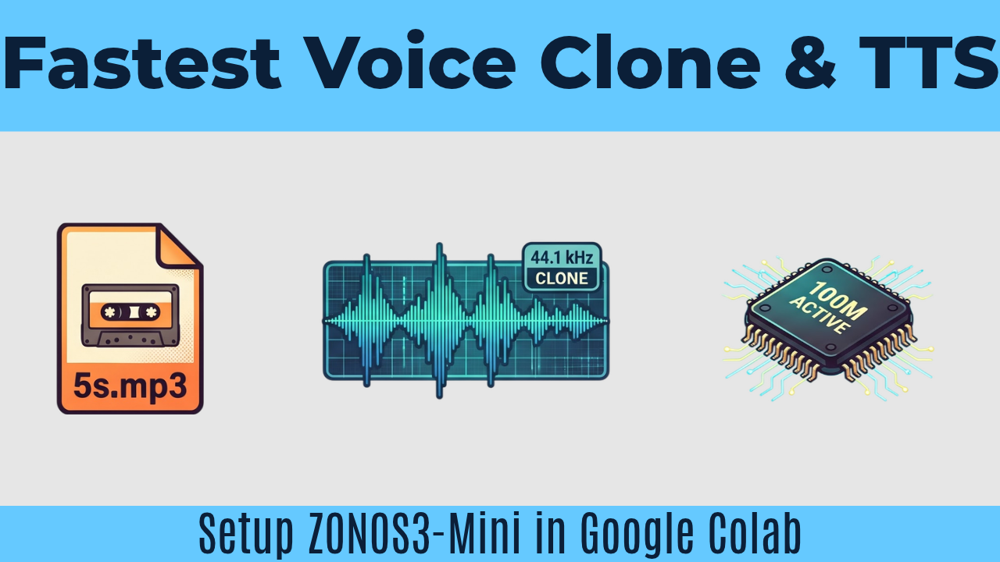

# 🎙️ ZONOS3-Mini (43-Language TTS & Voice Cloning) in Google Colab

This repository provides a streamlined, easy-to-use Google Colab notebook for running **Zyphra/ZONOS3-Mini** directly in PyTorch. Using a lightweight 100M-active-parameter architecture (800M total) with a 15 Hz audio codec, it generates crisp **44.1 kHz** speech across **43 languages**, includes **27 built-in voices**, and performs **zero-shot voice cloning without needing a reference transcript**—all running smoothly on a free Google Colab T4 GPU.

**🎥 Watch the Tutorial:** [How to Use](https://www.youtube.com/watch?v=7lEG7iG9qoI)

**🚀 Run in Colab:** [Open Google Colab Notebook](https://colab.research.google.com/drive/18PR4vBlQrgUmFkjaBoUhjgE6Y6SrxxaH?usp=sharing)

---

## ✨ Features Supported in this Notebook

This notebook packages the complete ZONOS3-Mini text-to-speech and voice cloning workflow into 4 automated cells:

1. **⚙️ Install Dependencies**: Installs Hugging Face `transformers`, `soundfile`, `einops`, and Zyphra's prebuilt `zyphra-textnorm` text normalizer.
2. **🧠 Load ZONOS3-Mini Model & Built-in Voices**: Loads `Zyphra/ZONOS3-Mini-hf` onto your Colab GPU and automatically downloads all **27 precomputed voice embeddings** (`.embedding.npy`) from `Zyphra/ZONOS3-Mini`.
3. **🗣️ Standard Text-to-Speech (All 43 Languages)**:
   * **43 Languages Supported:** English, French, Spanish, German, Italian, Portuguese, Dutch, Greek, Swedish, Danish, Norwegian, Finnish, Polish, Czech, Slovak, Hungarian, Romanian, Bulgarian, Russian, Ukrainian, Turkish, Arabic, Hebrew, Georgian, Mandarin Chinese, Japanese, Korean, Vietnamese, Indonesian, Malay, Thai, Tagalog, plus 11 Indian languages (Hindi, Bengali, Tamil, Telugu, Marathi, Gujarati, Kannada, Malayalam, Punjabi, Odia, and Urdu).
   * **27 Built-in Character & Accent Voices:** Choose from American, British, Irish, Anime, Witch, Announcer, ASMR, and multilingual voices—or use `auto` / `none`.
   * **Full Parameter Controls:** Adjust `temperature`, `top_p`, `top_k`, `repetition_penalty`, `max_new_frames` (15 frames = 1 second; up to 1,500 frames), and `seed` for reproducible results.
4. **🎭 Zero-Shot Voice Cloning (No Transcript Needed)**:
   * Upload any clean 5–30 second reference audio clip (`.wav`, `.mp3`, or `.flac`) and clone the voice across all **43 languages**—no reference transcript required.
   * Fine-tune voice similarity using `speaker_cfg_scale` (`1.0` = off; `1.2–1.8` for stronger adherence to the reference voice).
   * Automatically cleans up uploaded reference files after generation to keep your Colab workspace tidy.

## 🛠️ How to Use

1. Click the **Open in Colab** badge above.
2. Go to **Runtime > Change runtime type** in the top menu and ensure **T4 GPU** is selected.
3. Run **Cell 1 (Install Dependencies)** to set up the required packages.
4. Run **Cell 2 (Load ZONOS3-Mini Model & Built-in Voices)** to download the model and all 27 built-in voice embeddings.
5. **For Standard Text-to-Speech (Cell 3):**
   * Type your script into `target_text`.
   * Pick a voice from the `voice_name` dropdown (or leave it on `auto` / `none`).
   * Choose your `language` from the 43-language dropdown, adjust length via `max_new_frames` (`450` frames = up to 30 seconds), and click **Play**.
6. **For Zero-Shot Voice Cloning (Cell 4):**
   * Type the new speech into `target_text` and pick your target `language`.
   * Keep `speaker_cfg_scale` around `1.2` (or increase up to `1.8` for a closer match).
   * Click **Play**, upload your 5–30 second `.wav`, `.mp3`, or `.flac` audio clip when prompted, and listen to or download your cloned voice right inside the notebook!

## 🤝 Credits

* **Notebook Creator:** [@CoinNoin](https://www.youtube.com/@CoinNoin)
* **Base Models & Voices (Apache 2.0):** [Zyphra / ZONOS3-Mini-hf](https://huggingface.co/Zyphra/ZONOS3-Mini-hf) & [Zyphra / ZONOS3-Mini](https://huggingface.co/Zyphra/ZONOS3-Mini)
